# Carrel



**Carrel for macOS** は、デスクトップ版 [Anki](https://apps.ankiweb.net/) のカードを編集・閲覧するための補助アプリ (macOS) です。
カードの検索・編集・プレビューに特化していて、Anki が終了している間に Anki のコレクションを直接開いて編集します。
Anki を置き換えるものではなく、Anki と組み合わせて使う「書きやすい机」です。

> Anki は Ankitects Pty Ltd の商標です。Carrel は Ankitects とは無関係の個人プロジェクトで、Ankitects の承認や保証を受けたものではありません。
> Carrel は AnkiWeb に接続しません。AnkiWeb との同期は、Anki 本体 (承認されたクライアント) で行ってください。

## 主な機能

- **検索と一覧**: Anki の検索構文、タグ・デッキでの絞り込み、丸数字を正しく並べる並べ替え
- **HTML エディタ**: 構文色付け、折りたたみ、タグの対応ハイライト、検索と置換 (このノート / すべてのノート)、自動閉じタグ、画像のペースト
- **ライブプレビュー**: ノートタイプの CSS とテンプレートをそのまま適用。画像のライトボックス、カード内検索
- **Anki 本体と同じコレクション**: Anki のプロフィールを直接開いて編集する。Carrel 自身はネットワークに接続せず、AnkiWeb との同期は Anki 本体に任せる
- **AI 支援 (任意)**: Claude / ChatGPT / Gemini の API キーを入れると、カードの書き換え・整形を依頼できる。キーは自分で用意し、送信されるのは依頼したカードの本文だけ (使わなければ Carrel は外部に通信しない)
- **テンプレート編集・メディア整理・スニペット**

## インストール

[Releases](https://github.com/Kissamine/carrel/releases) から `Carrel-<version>-mac-arm64.dmg` を取得し、
Carrel.app を Applications に入れてください。Apple Silicon (M1 以降) の Mac と macOS 13 以降が必要です。

### 初回起動

現在は Apple の署名・公証を行っていないため、初回に「開発元を確認できません」と出ます。
次のどちらかで開けます。

- Finder で Carrel.app を **右クリック › 開く** を選び、ダイアログで「開く」を押す
- またはターミナルで隔離属性を外す:
  ```bash
  xattr -d com.apple.quarantine /Applications/Carrel.app
  ```

2 回目以降は普通に開けます。

## 使い方

1. Mac に [Anki](https://apps.ankiweb.net/) を入れて一度起動し、AnkiWeb と同期しておきます
2. Anki を終了して Carrel を開くと、Anki のプロフィール (`~/Library/Application Support/Anki2/<名前>/`) のカードが一覧に出ます。プロフィールが複数あるときは 設定 › Anki で選びます
3. 左の一覧からカードを選ぶと右にプレビューが出ます。鉛筆アイコンで編集に入り、⌘S で保存します
4. 変更を AnkiWeb に送るときは右上の「Anki を開いて同期」ボタンを押します。Carrel がコレクションを手放して Anki を開くので、Anki の同期ボタンを押してください (同期は常に Anki 本体が行います)
5. Anki を起動している間、Carrel は待機します (Anki を終了すると自動で再開)。Carrel の窓が裏に回ったときもコレクションを手放すので、Anki をいつでも開けます

Carrel 自身の設定やバックアップは `~/Library/Application Support/Carrel/` に置かれます。

### AnkiWeb について

AnkiWeb の利用規約は、承認されたクライアント (Anki、AnkiMobile、AnkiDroid、AnkiUniversal) 以外からの接続を認めていません。
Carrel はこれに従い、AnkiWeb に一切接続しません。Carrel が行うのは Mac 上のコレクションファイルの読み書きだけで、
AnkiWeb とのやり取りは Anki 本体で行ってください。

## ソースからビルドする

```bash
git clone https://github.com/Kissamine/carrel.git
cd ankieditor/macos && python3 -m venv .venv && .venv/bin/pip install anki
cd ../electron && npm install
npm start            # 開発用に起動
npm run dist         # dist/ に dmg と zip を作る (無署名)
```

署名・公証つきで配る手順は [RELEASING.md](RELEASING.md) を参照してください。

## 構成

```
electron/     macOS 版 Carrel (Electron + 同梱 Python の anki ライブラリ)
ios/          iOS 版 (SwiftUI、閲覧のみ。Anki のプロフィールのフォルダを取り込んで読む)
macos/bridge/ Python ブリッジ (anki ライブラリとの橋渡し)
app/ shared/  以前の Android 版と Compose 版 (保守は停止)
```

## ライセンス

Copyright © 2026 Kujo Haru

[AGPL-3.0-or-later](LICENSE)。同梱しているソフトウェアのライセンスは [THIRD_PARTY_NOTICES.md](THIRD_PARTY_NOTICES.md) にまとめています。
